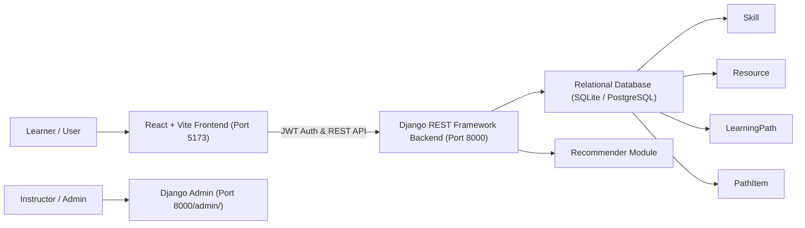

# Learning Path Dashboard

An intelligent web application where users sign up, select a skill goal (such as **"Python for Data Science"** or **"Full-Stack Web Development"**), and receive a structured, difficulty-ranked learning path. The app tracks individual progress, records completion timestamps and ratings, and visualizes real database analytics in a personal dashboard.

---

## Architecture Overview



### Relational Data Models (Unit V)
- **`Skill`**: Subject or goal (`name`, `description`, `category`).
- **`Resource`**: Learning resource with foreign key to `Skill` (`title`, `url`, `resource_type`, `difficulty` [1=Beginner, 2=Intermediate, 3=Advanced], `duration_minutes`).
- **`LearningPath`**: Learner's enrolled path with foreign keys to `User` and `Skill` (`created_at`, `updated_at`).
- **`PathItem`**: Ordered resource milestone with foreign keys to `LearningPath` and `Resource` (`order`, `completed`, `completed_at`, `rating` [1-5 stars]).

---

## Preserved Reference Projects

All original reference repositories provided in Downloads are preserved under [`existing_projects/`](./existing_projects/):
- **[`existing_projects/LearningPathDashboard/`](./existing_projects/LearningPathDashboard/)**: Original React/Vite dashboard layout.
- **[`existing_projects/fullstack-learning-path/`](./existing_projects/fullstack-learning-path/)**: Interactive Full-Stack TypeScript roadmap with milestone rail.
- **[`existing_projects/LearnPress-Learning-Path-Dashboard/`](./existing_projects/LearnPress-Learning-Path-Dashboard/)**: Course sequencing plugin reference.
- **[`existing_projects/Data-Science-learning-path/`](./existing_projects/Data-Science-learning-path/)**: Comprehensive curriculum and 5 ML projects used to seed the database.

---

## Prerequisites (Windows)

- **Python**: 3.10+ (Verified on Python 3.14.6)
- **Node.js**: 18+ (Verified on Node v22.20.0)
- **npm**: 9+ (Verified on npm 11.5.2)

---

## Setup & Running on Windows

### 1. Clone or Open the Project
Open PowerShell inside `c:\Users\hp\OneDrive\Desktop\project\Djangoprojects`:
```powershell
cd c:\Users\hp\OneDrive\Desktop\project\Djangoprojects
```

### 2. Backend Setup (Django & DRF)

1. Open PowerShell and install backend dependencies:
   ```powershell
   python -m pip install -r requirements.txt
   ```

2. Run migrations to generate the database schema:
   ```powershell
   cd backend
   python manage.py makemigrations
   python manage.py migrate
   ```

3. Populate real skills, resources, and demo accounts:
   ```powershell
   python seed_data.py
   ```

4. Start the Django development server:
   ```powershell
   python manage.py runserver 0.0.0.0:8000
   ```
   Backend will be running at `http://127.0.0.1:8000`.

---

### 3. Frontend Setup (React & Vite)

1. In a new PowerShell window, navigate to `frontend`:
   ```powershell
   cd c:\Users\hp\OneDrive\Desktop\project\Djangoprojects\frontend
   ```

2. Install dependencies:
   ```powershell
   npm install
   ```

3. Launch the Vite dev server:
   ```powershell
   npm run dev
   ```
   Frontend will be running at `http://localhost:5173`.

---

## Pre-configured Demo Accounts

After running `seed_data.py`, the following accounts are ready to use:

| Role | Username | Password | Purpose |
| :--- | :--- | :--- | :--- |
| **Learner** | `learner_demo` | `LearnerPass123!` | Has pre-enrolled paths with real completion logs & streak |
| **Admin** | `admin` | `AdminPass123!` | Access to Django Admin (`/admin/`) and Instructor management |

---

## Running the Automated Test Suite

To verify user signup, learning path generation, difficulty ordering, completion toggle, real database analytics, and user isolation:

```powershell
cd c:\Users\hp\OneDrive\Desktop\project\Djangoprojects\backend
python manage.py test
```

Expected output:
```text
Creating test database for alias 'default'...
.....
----------------------------------------------------------------------
Ran 5 tests in ~3.0s

OK
```

---

## API Endpoints Reference

| Method | Endpoint | Description | Auth Required |
| :--- | :--- | :--- | :--- |
| `POST` | `/api/auth/signup/` | Register new learner account | No |
| `POST` | `/api/auth/login/` | Obtain JWT access and refresh tokens | No |
| `GET` | `/api/auth/me/` | Fetch current user profile | Yes (Bearer token) |
| `GET` | `/api/skills/` | List all available skill goals | No |
| `GET` | `/api/resources/` | Filter resources by skill or difficulty | Yes |
| `GET` | `/api/paths/` | List current user's enrolled paths | Yes |
| `POST` | `/api/paths/` | Generate difficulty-ranked path from skill | Yes |
| `GET` | `/api/paths/<id>/` | Fetch path detail with ordered items | Yes |
| `POST` | `/api/items/<id>/complete/` | Toggle completion status (`completed_at`) | Yes |
| `POST` | `/api/items/<id>/rate/` | Rate resource (1–5 stars) | Yes |
| `GET` | `/api/dashboard/stats/` | Live database analytics & weekly activity | Yes |

---

## Instructor Group Permissions (Unit V & VI)

The `seed_data.py` script automatically configures an **Instructor** permission group in Django Admin:
- Instructors can add, change, and view `Skill` and `Resource` models.
- Instructors **cannot** delete `User` accounts.
