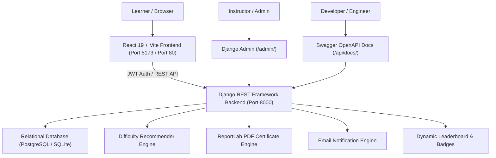

# Learning Path Dashboard

An enterprise-ready, full-stack learning platform where users sign up, choose a skill goal (such as **"Python for Data Science"**, **"Full-Stack Web Development"**, or **"Django Backend"**), and get an ordered, difficulty-ranked learning roadmap.

The system tracks real learning progress, awards milestone badges, hosts a community leaderboard, sends email notifications, and auto-generates official PDF Certificates of Completion.

---

## Architecture Overview



---

## 🌟 6 Production Enterprise Features

### 1. REST API with Interactive Swagger Docs
- Built with **`drf-spectacular`** conforming to OpenAPI 3.0.
- Interactive Swagger UI: [http://127.0.0.1:8000/api/docs/](http://127.0.0.1:8000/api/docs/)
- Redoc API Documentation: [http://127.0.0.1:8000/api/redoc/](http://127.0.0.1:8000/api/redoc/)
- Raw OpenAPI JSON/YAML Schema: [http://127.0.0.1:8000/api/schema/](http://127.0.0.1:8000/api/schema/)

### 2. Google OAuth & JWT Authentication
- One-click Google Sign-In button on both `/login` and `/signup`.
- Backed by `POST /api/auth/google/` with token verification, user provisioning, and secure JWT issuance.

### 3. Automated Email Notifications
- **Welcome Email:** Triggered automatically upon registration.
- **Streak Celebrations:** Fires on milestone consecutive day streaks (3, 5, 7, 14, 30 days).
- **Track Completion:** Congratulatory email with direct link to download the PDF certificate when a learner hits 100%.
- Development backend logs directly to console (`console.EmailBackend`), production switches to SMTP via `.env`.

### 4. Achievement Badges, Community Leaderboard & PDF Certificates
- **Leaderboard (`/leaderboard`):** Real-time podium ranking top learners by completed hours, modules, and streak.
- **Milestone Badges:** Automatically earned (First Milestone, Consistent Learner, Skill Scholar, Deep Diver, Track Champion).
- **Official PDF Certificate:** Generated via ReportLab (`GET /api/paths/<id>/certificate/`) with cryptographic verification ID, custom styling, issue date, and director signature.

### 5. Automated CI/CD with GitHub Actions
- Workflow located at [`.github/workflows/ci.yml`](./.github/workflows/ci.yml).
- Automatically triggers on every `push` and `pull_request` to `main`:
  - Runs all 9 Django backend unit tests.
  - Verifies database migrations.
  - Builds the React + Vite production bundle.

### 6. Docker & Docker Compose
Spin up the entire stack (PostgreSQL 16, Redis 7, Django REST backend, and React/Nginx frontend) in one command:
```bash
docker compose up --build
```
- Frontend: `http://localhost:5173` or `http://localhost:80`
- Backend: `http://localhost:8000`
- Database: PostgreSQL on port `5432`

---

## Local Setup on Windows (Without Docker)

### 1. Backend (Django REST Framework)
```powershell
cd backend
python -m pip install -r ../requirements.txt
python manage.py migrate
python seed_data.py
python manage.py runserver 0.0.0.0:8000
```

### 2. Frontend (React + Vite)
```powershell
cd frontend
npm install
npm run dev
```
Open **[http://localhost:5173/](http://localhost:5173/)**.

---

## Pre-configured Demo Accounts

| Role | Username | Password |
| :--- | :--- | :--- |
| **Learner** | `learner_demo` | `LearnerPass123!` |
| **Admin** | `admin` | `AdminPass123!` |

---

## Running the Automated Test Suite

```powershell
cd backend
python manage.py test learning
```

Test coverage includes:
- User signup & JWT token creation
- Google OAuth login endpoint
- Difficulty-ranked path generation (Level 1 $\rightarrow$ 2 $\rightarrow$ 3)
- Module completion timestamps & 5-star ratings
- Dynamic leaderboard & badge calculation
- PDF certificate binary generation
- Swagger OpenAPI schema generation
- Database analytics metrics verification
- Strict user data isolation
