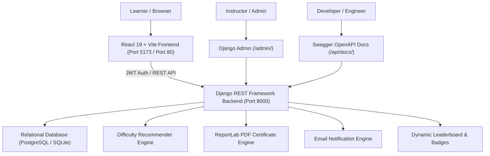

# Learning Path Dashboard

An enterprise-ready, full-stack learning platform where users sign up, choose a skill goal (such as **"Python for Data Science"**, **"Full-Stack Web Development"**, or **"Django Backend"**), and get an ordered, difficulty-ranked learning roadmap.

The system tracks real learning progress, awards milestone badges, hosts a community leaderboard, sends email notifications, and auto-generates official PDF Certificates of Completion.

---

## Architecture Overview



---

## How Django Works in This Project

Django is used as a server-side application and REST API platform:

| Django part | File | Responsibility |
|---|---|---|
| Settings | [`backend/core/settings.py`](./backend/core/settings.py) | Database, allowed hosts, CORS, JWT, email, REST and Swagger configuration |
| URL routing | [`backend/core/urls.py`](./backend/core/urls.py) | Connects `/admin/`, `/api/`, Swagger and the React API routes |
| API routing | [`backend/learning/urls.py`](./backend/learning/urls.py) | Maps URL paths such as `/api/paths/` to Django views |
| Models | [`backend/learning/models.py`](./backend/learning/models.py) | Defines database tables and relationships; Django ORM converts Python code into SQL |
| Views | [`backend/learning/views.py`](./backend/learning/views.py) | Processes HTTP requests, permissions, database operations and JSON responses |
| Serializers | [`backend/learning/serializers.py`](./backend/learning/serializers.py) | Converts model objects to/from JSON and validates signup and API input |
| Migrations | [`backend/learning/migrations/`](./backend/learning/migrations/) | Stores database schema changes and creates/updates tables safely |
| Recommender | [`backend/learning/recommender.py`](./backend/learning/recommender.py) | Generates difficulty-ranked `PathItem` records for a selected skill |
| Certificates | [`backend/learning/certificates.py`](./backend/learning/certificates.py) | Generates PDF certificates using ReportLab |
| Notifications | [`backend/learning/notifications.py`](./backend/learning/notifications.py) | Sends welcome, streak and completion emails |
| Tests | [`backend/learning/tests.py`](./backend/learning/tests.py) | Verifies authentication, paths, milestones, ratings, leaderboard and certificates |

### Model Relationships

- `User` is Django's built-in authentication model.
- `Skill` represents a learning goal.
- `Resource` belongs to one `Skill` and can be a video, article, course or project.
- `LearningPath` belongs to one `User` and one `Skill`.
- `PathItem` connects a `LearningPath` to a `Resource`, and stores order, completion time and rating.
- One `LearningPath` contains many `PathItem` records.
- Deleting a parent object removes its dependent records according to its foreign-key cascade rules.

For example, an enrollment request follows this flow:

```text
React skill button
  -> POST /api/paths/ with skill_id
  -> LearningPathListCreateView in views.py
  -> LearningPath and PathItem models
  -> PathRecommender orders resources by difficulty
  -> LearningPathDetailSerializer converts the result to JSON
  -> React displays the personalized path
```

### Django Concepts Used

- **MTV/MVT:** Django receives an HTTP request, a view performs the logic, a model handles database data, and a serializer produces JSON (instead of a server-rendered template).
- **ORM:** `LearningPath.objects.filter(user=request.user)` queries the database without hand-written SQL.
- **Relations:** `ForeignKey`, `related_name`, `unique_together`, prefetching and cascade deletion define model relationships and avoid duplicate ownership records.
- **DRF:** APIView and GenericAPIView provide HTTP endpoints, JSON validation and response handling.
- **Authentication:** Simple JWT access/refresh tokens authenticate API requests with `Authorization: Bearer <access-token>`.
- **Permissions:** `IsAuthenticated` and `IsOwner` prevent users from viewing or changing another user's paths.
- **Migrations:** Django's migration system tracks database schema evolution.
- **Admin:** `/admin/` provides a built-in database administration interface.
- **OpenAPI:** drf-spectacular generates Swagger UI at `/api/docs/` and Redoc at `/api/redoc/`.

---

## Commands to Run and Understand

```powershell
# From the project root

# Install backend dependencies
python -m pip install -r requirements.txt

# Enter/manage the Django backend
cd backend
python manage.py check             # Validate Django configuration
python manage.py makemigrations    # Create migration files after model changes
python manage.py migrate           # Apply migrations to the database
python seed_data.py                # Load demo skills and resources
python manage.py createsuperuser   # Create an admin account
python manage.py runserver 127.0.0.1:8000

# Run backend tests
python manage.py test learning

# Open Swagger: http://127.0.0.1:8000/api/docs/
# Open Django Admin: http://127.0.0.1:8000/admin/

# In a new terminal, run the React frontend
cd frontend
npm install
npm run dev

# Frontend validation
npm run lint
npm run build
```

Stop a running server with `Ctrl+C`.

---

## GitHub Repository and Git Workflow

Repository: [https://github.com/Umashankar12345/Learning-path-system](https://github.com/Umashankar12345/Learning-path-system)

```powershell
# Check remote and changes
git remote -v
git status

# Save a change
 git add backend frontend README.md
git commit -m "Add learning platform feature"
git push origin main

# Create and switch to a feature branch
git switch -c feature/my-feature
# Push the branch
git push -u origin feature/my-feature
```

Do not commit `.env`, database credentials, API keys or generated `node_modules/` and `dist/` directories.

---

## What Makes This Learning Platform Different

### Already Implemented

- **Personalized ordered paths:** A selected skill is expanded into a Beginner → Intermediate → Advanced sequence.
- **Real progress tracking:** Module completion, timestamps, rating, overall percentage and study hours are stored in the database.
- **Adaptive next recommendation:** The dashboard identifies the lowest-difficulty unfinished milestone.
- **Live analytics:** Active paths, completed modules, 7-day activity, streak and next milestone are calculated dynamically.
- **Leaderboard and badges:** Rankings use real completion data and produce achievement badges automatically.
- **Certificate generation:** A completion certificate is generated as a personalized PDF with verification ID.
- **JWT and Google authentication:** Standard username/password and Google ID-token authentication paths are available.
- **Email notifications:** Welcome, streak and completion notifications are implemented.
- **User isolation:** A learner can only access and modify their own learning paths.
- **API documentation:** Swagger and Redoc expose and test all API operations.
- **Teacher-reviewed GitHub projects:** Learners submit repository links and reflections for project milestones; instructors can approve work or request revisions and provide feedback visible in the learner's path.

### Teacher Review Workflow

1. A teacher adds a resource with type **Project** in Django Admin.
2. The learner opens that project milestone and submits a GitHub repository URL and short reflection.
3. The teacher opens **Project submissions** in Django Admin and selects **Approved** or **Revision requested**, then writes feedback.
4. The learner sees the review state and feedback in their learning path and can resubmit after making changes.

The submission endpoint is `POST /api/items/<item-id>/submission/`. It only accepts GitHub repository URLs and ensures submissions are scoped to the signed-in learner's own project milestone. Use a staff instructor account to review submissions in `/admin/`.

### Strong Extra Features to Add Next

1. **AI learning-path explanation:** Explain *why* a resource was placed at a particular level and let the learner adjust pace or role.
2. **Skill prerequisite graph:** Prevent advanced modules until prerequisite skills or quizzes are passed.
3. **Adaptive difficulty with quizzes:** Ask short checks and move learners forward, revise, or repeat content based on confidence.
4. **Learning calendar and reminders:** Scheduling, due dates, weekly goals and browser/email reminders.
5. **Verified GitHub profile import:** Link a learner's GitHub account and automatically display public repositories, contribution history and project activity with explicit user consent.
6. **Verified portfolio/profile:** Public shareable learning profile containing certificates, teacher-reviewed projects, skills, streak and feedback.
7. **Resource quality feedback:** Sort and recommend content based on learner ratings and completion rates, not only static difficulty.
8. **Collaborative study rooms:** Shared goals, team leaderboard, discussion threads and progress accountability.
9. **Offline or mobile support:** PWA installation, offline milestone state and later synchronization.

The current differentiators are difficulty-aware sequencing, a teacher feedback loop on real GitHub work, a live timed coding judge, dynamic next recommendations, leaderboard/badges, PDF certificates and user-owned analytics. For a classroom or hackathon demo, show an actual challenge accepted by Judge0, then submit project code to a teacher, receive requested revisions, and resubmit for approval.

---

## 🌟 8 Production Enterprise Features

### 1. REST API with Interactive Swagger Docs
- Built with **`drf-spectacular`** conforming to OpenAPI 3.0.
- Interactive Swagger UI: [http://127.0.0.1:8000/api/docs/](http://127.0.0.1:8000/api/docs/)
- Swagger uses the project's dark-slate and indigo theme via `backend/templates/learning/swagger_ui.css`.
- Redoc API Documentation: [http://127.0.0.1:8000/api/redoc/](http://127.0.0.1:8000/api/redoc/)
- Raw OpenAPI JSON/YAML Schema: [http://127.0.0.1:8000/api/schema/](http://127.0.0.1:8000/api/schema/)

### 2. Google OAuth & JWT Authentication
- One-click Google Sign-In button on both `/login` and `/signup`.
- Backed by `POST /api/auth/google/` with token verification, user provisioning, and secure JWT issuance.

### 3. Automated Email Notifications
- **Welcome Email:** Triggered automatically upon registration.
- **Streak Celebrations:** Fires on milestone consecutive day streaks (3, 5, 7, 14, 30 days).
- **Track Completion:** Congratulatory email with direct link to download the PDF certificate when a learner hits 100%.
- Development backend logs directly to console (`console.EmailBackend`), production switches to SMTP via `.env`.

### 4. Achievement Badges, Community Leaderboard & PDF Certificates
- **Leaderboard (`/leaderboard`):** Real-time podium ranking top learners by completed hours, modules, and streak.
- **Milestone Badges:** Automatically earned (First Milestone, Consistent Learner, Skill Scholar, Deep Diver, Track Champion).
- **Official PDF Certificate:** Generated via ReportLab (`GET /api/paths/<id>/certificate/`) with cryptographic verification ID, custom styling, issue date, and director signature.

### 5. Automated CI/CD with GitHub Actions
- Workflow located at [`.github/workflows/ci.yml`](./.github/workflows/ci.yml).
- Automatically triggers on every `push` and `pull_request` to `main`:
  - Runs the Django learning-app test suite.
  - Verifies database migrations.
  - Builds the React + Vite production bundle.

### 6. Docker & Docker Compose
Spin up the entire stack (PostgreSQL 16, Redis 7, Django REST backend, and React/Nginx frontend) in one command:
```bash
docker compose up --build
```
- Frontend: `http://localhost:5173` or `http://localhost:80`
- Backend: `http://localhost:8000`
- Database: PostgreSQL on port `5432`

### 7. Teacher-Reviewed GitHub Project Work
- Learners attach their GitHub repository and a short reflection to hands-on project milestones.
- Project forms can browse up to 100 public repositories by GitHub username through `GET /api/github/users/<username>/repositories/`; no GitHub credentials are requested and private repositories are not accessed.
- Teachers review, approve or request revisions, and leave feedback through Django Admin.
- Feedback is returned to the learner's roadmap, creating a practical build → review → improve loop.
- The project source is linked in the site navigation and footer: [GitHub repository](https://github.com/Umashankar12345/Learning-path-system).

### 8. Timed Coding Arena with Hosted Automated Judging
- Database-backed Python challenges and sample/hidden test cases are installed by migrations.
- Server-created attempts enforce each challenge's deadline and are scoped to the signed-in learner.
- Submissions are actually sent to the configured Judge0-compatible API with CPU, wall-time and memory limits; results are saved and returned per test case.
- Problems can be filtered by difficulty and topic; authenticated submission history is stored, and a reference solution unlocks after the learner's first submission.
- The dashboard highlights a rotating daily problem and coding streak. Skills can optionally link a roadmap module to a problem that must be passed before marking that module complete.
- If the hosted judge is not configured or cannot return a result, the UI shows an explicit error and does not award a pass.
- Configure `JUDGE0_API_URL` and any required `JUDGE0_API_KEY` / `JUDGE0_API_HOST` values in `.env` before starting an attempt. Local development defaults to Judge0 CE.

### 9. Placement Assessment and Skill Radar
- Each skill can be seeded with ten multiple-choice placement questions across three difficulty levels. The assessment uses existing `Skill` IDs as track IDs; no duplicate Track model is introduced.
- `GET /api/tracks/<skill-id>/placement-quiz/` returns questions without their answer keys. Authenticated `POST /api/tracks/<skill-id>/placement-submit/` grades the attempt, recommends a starting level, creates or reuses the learner's path, and completes lower-level modules.
- The placement score and per-level skill-gap breakdown are recorded in the database. Level recommendations are deterministic and based on accuracy at each difficulty; no external AI inference is claimed.
- `GET /api/analytics/skill-radar/` returns 0–100 scores by enrolled skill, combining module completion (50%), relative study hours (25%), and the latest placement score (25%). The dashboard renders the values in a responsive Recharts radar chart.
- The dashboard's **Enroll New Goal** action and skill cards open the placement quiz before navigating to the personalized roadmap.

### 10. Expanded Skill Catalog
- The catalog includes ten additional tracks: Python Programming, Data Structures & Algorithms, JavaScript Essentials, Frontend with React, HTML & CSS, SQL & Databases, Git & GitHub, Docker & Deployment, Generative AI & LLMs, and Web Security Basics.
- The new tracks add 62 difficulty-ranked modules and ten placement questions per track, using vetted documentation and learning resources.
- The Skills page builds category filter pills from the API data, so categories stay in sync as the catalog changes.
- Run `python seed_data.py` from `backend/` to seed or update the catalog without duplicating matching skills, resources, or placement questions.

---

## Local Setup on Windows (Without Docker)

### 1. Backend (Django REST Framework)
```powershell
cd backend
python -m pip install -r ../requirements.txt
python manage.py migrate
python seed_data.py
python manage.py runserver 0.0.0.0:8000
```

### 2. Frontend (React + Vite)
```powershell
cd frontend
npm install
npm run dev
```
Open **[http://localhost:5173/](http://localhost:5173/)**.

### Configure Google Sign-In

The Google button stays disabled until you create a **Web application OAuth client ID** in Google Cloud Console. Add the same real client ID to the repository-root `.env` file:

```env
GOOGLE_CLIENT_ID=your-real-client-id.apps.googleusercontent.com
VITE_GOOGLE_CLIENT_ID=your-real-client-id.apps.googleusercontent.com
```

In the OAuth client's authorized JavaScript origins, add `http://localhost:5173` and `http://127.0.0.1:5173`. The string `your-google-web-client-id.apps.googleusercontent.com` is only an example and will not authenticate. Restart both Django and Vite after editing `.env`.

### Configure the Real Coding Judge

The Coding Arena sends learner-submitted Python source code to the Judge0-compatible hosted execution service. The local development configuration uses Judge0 CE (`https://ce.judge0.com`); override it and add provider credentials in the repository-root `.env` if needed:

```env
JUDGE0_API_URL=https://ce.judge0.com
JUDGE0_API_KEY=
JUDGE0_API_HOST=
```

Set `JUDGE0_API_HOST` only if the provider requires the RapidAPI host header; do not commit real API keys. The start-attempt endpoint refuses to create an attempt when no judge URL is configured. Code is submitted with CPU, wall-time, and memory limits. The timer, ownership checks, and test-case results are enforced/stored by Django. Judge0 CE is a shared hosted service; submitted source code leaves this application and is sent to that provider. For production or a classroom competition, use a dedicated Judge0 deployment/account with appropriate reliability, privacy, and rate limits.

---

## Pre-configured Demo Accounts

| Role | Username | Password |
| :--- | :--- | :--- |
| **Learner** | `learner_demo` | `LearnerPass123!` |
| **Admin** | `admin` | `AdminPass123!` |

---

## Running the Automated Test Suite

```powershell
cd backend
python manage.py test learning
```

Test coverage includes:
- User signup & JWT token creation
- Google OAuth login endpoint
- Difficulty-ranked path generation (Level 1 $\rightarrow$ 2 $\rightarrow$ 3)
- Module completion timestamps & 5-star ratings
- Dynamic leaderboard & badge calculation
- PDF certificate binary generation
- Swagger OpenAPI schema generation
- Database analytics metrics verification
- Strict user data isolation
